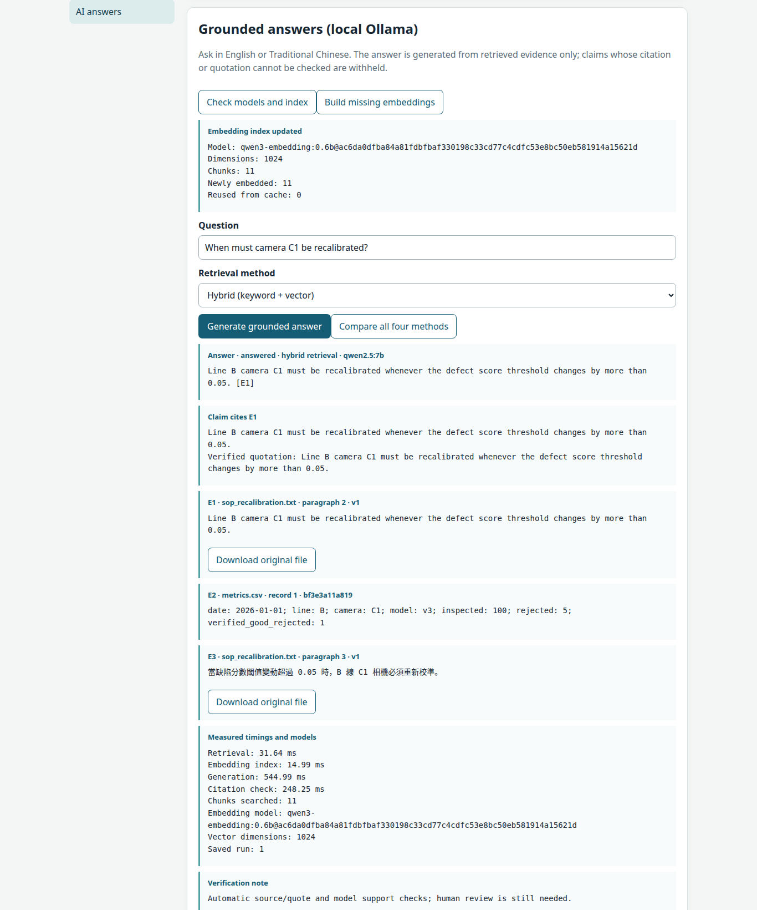
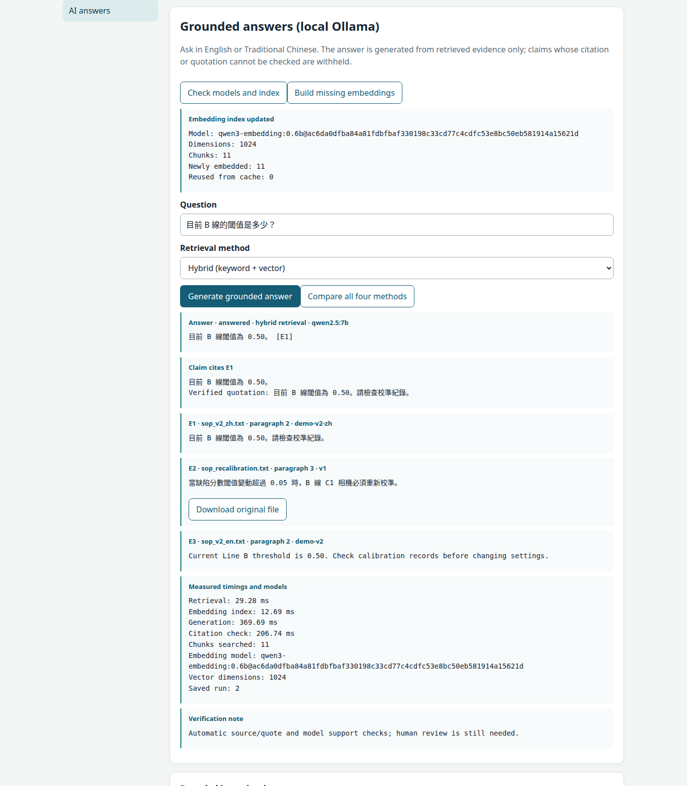
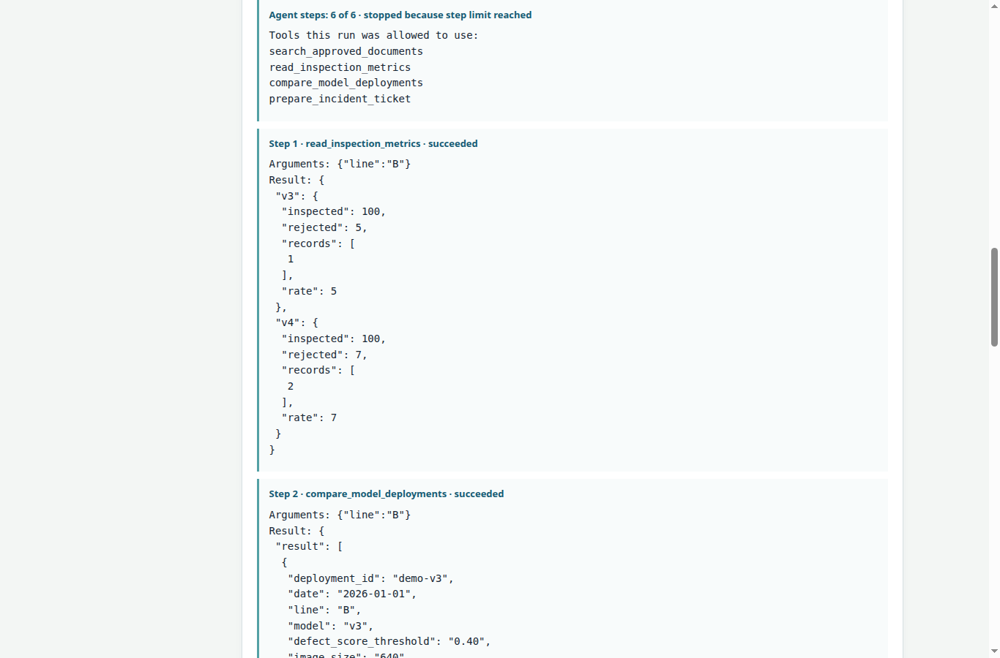
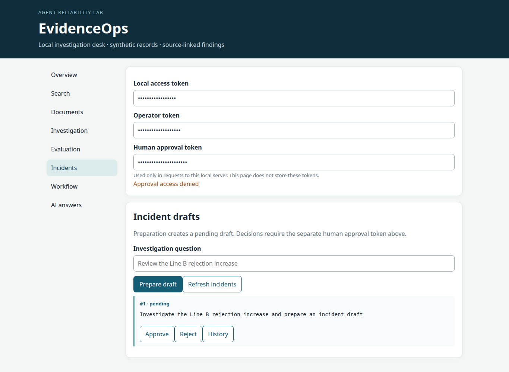
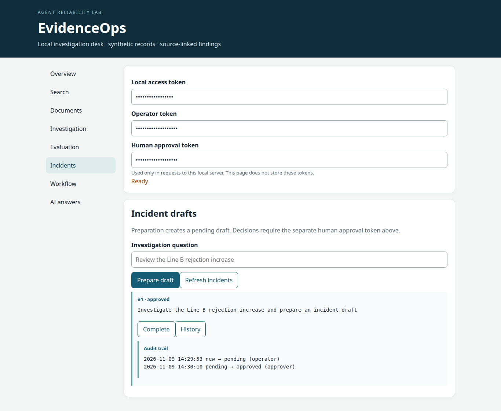
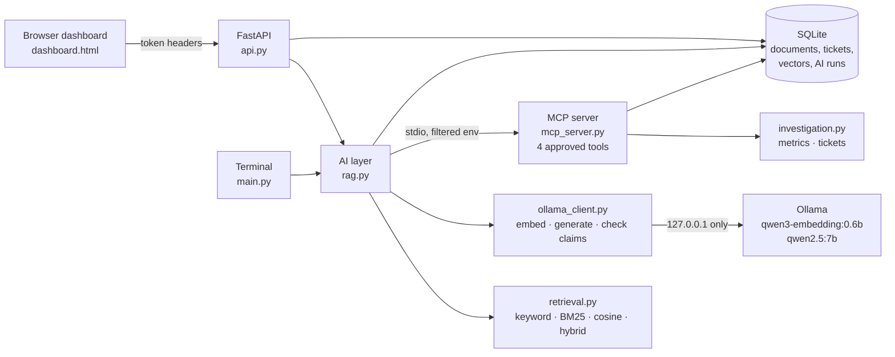

# EvidenceOps

**Evidence-grounded RAG and a bounded MCP agent for manufacturing quality investigations — local, bilingual (English and Traditional Chinese), and human-approved.**

[](https://github.com/manideepreddyyanala4-svg/LLM-RAG/actions/workflows/offline.yml)

EvidenceOps is a learning and portfolio project. It is **not production ready**, and it runs on **synthetic** data only.

## The problem

A camera-inspection line starts rejecting more parts after a new model version is deployed. An engineer has to answer questions like these:

- *What does the current SOP say?*
- *What changed between deployments?*
- *Should an incident be opened?*

The evidence is split across bilingual SOPs, inspection counts and deployment records.

A chatbot that answers confidently is dangerous here: one invented threshold or approver can send the investigation the wrong way. EvidenceOps is built around four rules:

1. **Every answer must cite retrieved evidence**, and every quotation is checked word for word in Python.
2. **When the evidence is not there, the system says so** instead of guessing.
3. **The agent's tools are limited in code**, not just in the prompt.
4. **Only a person holding a separate approval token can approve an incident.** The AI can only prepare a pending draft.

Everything runs locally: FastAPI, SQLite, and Ollama on `127.0.0.1`. No data is sent to a hosted model.

## Demo

[▶ Demo video (72 s, MP4)](docs/evidenceops-demo.mp4) — the real dashboard driven in headless Chrome against real Ollama models. It shows upload → embed → cited answers in English and Chinese → abstention → MCP agent → pending draft → approval denied with the wrong token → approval with the right one → audit trail.

| Cited answer (English, from a newly uploaded SOP) | Cited answer (Traditional Chinese) |
|---|---|
|  |  |

| Agent tool calls over MCP | Wrong approval token refused | Approved, with audit trail |
|---|---|---|
|  |  |  |

## What works

| Feature | Status |
|---|---|
| Keyword, BM25, semantic (vector) and hybrid retrieval over the same chunks | Works, tested |
| Real embeddings with `qwen3-embedding:0.6b` (1024 dimensions), cached per model digest | Works, tested |
| Grounded answers with `qwen2.5:7b`; citation and verbatim-quote checks; abstention | Works, tested |
| English and Traditional Chinese questions, documents and answers | Works; Chinese is weaker (see limitations) |
| Prompt-injection filter for passages that give orders to the AI | Works for the tested patterns; a heuristic |
| Bounded agent calling four approved tools through a real MCP server | Works, tested |
| Pending incident drafts; separate human approval token; audit trail | Works, tested |
| Document versions, soft delete and restore, original-file download, PDF text | Works, tested |
| Deterministic rejection-rate investigation and deployment comparison | Works, tested |
| SQLite persistence across restarts; backup and restore | Works, tested |
| Optional PostgreSQL/pgvector adapter | Tested in CI with synthetic records; not used by the API |
| Retrieval or answer accuracy on human-reviewed labels | **Not established.** No reviewed benchmark exists yet |

## Architecture



### How one answer is produced

1. **Retrieve.** Up to three chunks are ranked with the chosen method. Superseded and deleted versions are filtered out *before* ranking, so they can never be cited.
2. **Filter.** Passages that address the AI ("ignore previous instructions", "admin mode", 忽略…指示) are removed from the prompt and shown to the user as *excluded*.
3. **Generate.** The model must return JSON *claims*. Each claim has text, a citation such as `E1`, and a quotation. An empty list is the only way to abstain.
4. **Check in Python.** The citation must name a retrieved passage, and the quote must appear in it **word for word**.
5. **Check with the model.** Each claim is compared with *only* the passage it cites.
6. **Decide.** The answer is shown only if every check passes. Otherwise the status is `withheld` or `insufficient`, and the blocked claims are kept for a person to read. Every run is saved.

### How the agent is bounded

The agent plans one step at a time. Every rule below is enforced in Python, so it holds even if the model ignores its instructions. Unit tests use a scripted planner that ignores its instructions on purpose.

- It can use only four tools: search SOP evidence, read inspection metrics, compare deployments, and prepare an incident draft. There is no approve, SQL, shell, filesystem or network tool.
- It can take at most 6 steps. Each action has a per-run budget, and a used-up action is no longer offered.
- An action that was not offered at that step is refused. So are identical repeat calls.
- A draft and `finish` are offered only after an SOP search.
- Only one draft can be made per run. It records the person's original request, not text the model wrote.
- The MCP process is started without the approval secret, and without the operator secret unless drafting is allowed. **No tool can approve anything.**

### Why plain Python instead of an agent framework

The agent is a short `while` loop in `rag.py`. LangGraph was used in an earlier version and removed. A graph framework would add a dependency without changing what matters here: which actions are allowed, in what order, and how often. Those rules are about twenty lines of ordinary Python that a reviewer can read and a unit test can attack directly. MCP is kept because it is a real protocol boundary: tools run in a separate process with a reduced environment.

## Technology

Python 3.13/3.14 · FastAPI · Uvicorn · SQLite · Ollama (`qwen2.5:7b`, `qwen3-embedding:0.6b`) · MCP Python SDK (stdio) · pypdf · optional PostgreSQL/pgvector (psycopg) · plain HTML/CSS/JavaScript · `unittest` · GitHub Actions · Docker Compose.

## Run it

Tested from a fresh clone, in a new virtual environment, on Ubuntu 25.10 with Python 3.13.9 and Ollama 0.33.0.

```bash
# 1. Get the code and create an environment
git clone https://github.com/manideepreddyyanala4-svg/LLM-RAG.git
cd LLM-RAG
python3 -m venv .venv
.venv/bin/python -m pip install -r requirements.txt

# 2. Get the two local models (about 5.3 GB together)
ollama pull qwen2.5:7b
ollama pull qwen3-embedding:0.6b

# 3. Create the small synthetic demo data (refuses to overwrite existing files)
.venv/bin/python main.py demo

# 4. Run the tests (no Ollama needed)
.venv/bin/python -m unittest -q

# 5. Configure and start the server. Use your own long random tokens; all three must differ.
export EVIDENCEOPS_TOKEN='replace-with-a-long-random-access-token'
export EVIDENCEOPS_OPERATOR_TOKEN='replace-with-a-different-operator-token'
export EVIDENCEOPS_APPROVAL_TOKEN='replace-with-a-third-approval-token'
export EVIDENCEOPS_AI_ENABLED=1
export EVIDENCEOPS_MODEL=qwen2.5:7b
export EVIDENCEOPS_EMBEDDING_MODEL=qwen3-embedding:0.6b
.venv/bin/python -m uvicorn api:app --host 127.0.0.1 --port 8000
```

6. Open `http://127.0.0.1:8000/` and enter the three tokens at the top of the page.

On Windows, use `.venv\Scripts\python.exe` instead of `.venv/bin/python`, and `set NAME=value` instead of `export`.

### A complete example investigation

In the dashboard:

1. **Documents** → paste a new SOP and add it. Example text:

   ```
   DOCUMENT ID: demo-recal-v1
   STATUS: ACTIVE

   Line B camera C1 must be recalibrated whenever the defect score threshold changes by more than 0.05.

   當缺陷分數閾值變動超過 0.05 時，B 線 C1 相機必須重新校準。
   ```

2. **AI answers** → *Build missing embeddings*.
3. Ask `When must camera C1 be recalibrated?`, then `目前 B 線的閾值是多少？`, then `Who approved the Line C deployment in 2019?`. The last one should abstain.
4. Tick *Allow a pending incident draft* and run the agent with `Investigate the Line B rejection increase`.
5. **Incidents** → *Approve*. It is refused without the right approval token, and accepted with it. Then open *History*.

From the terminal (with the same environment variables set):

```bash
.venv/bin/python main.py ask --question "目前 B 線的閾值是多少？"
.venv/bin/python main.py agent --question "Investigate the Line B rejection increase" --allow-draft
.venv/bin/python main.py investigate      # deterministic rejection-rate report, no model
.venv/bin/python main.py aieval           # full recorded evaluation, writes data/local/ai_evaluation.json
```

### Environment variables

| Variable | Required | Purpose |
|---|---|---|
| `EVIDENCEOPS_TOKEN` | Yes | Access token; needed for every data request |
| `EVIDENCEOPS_OPERATOR_TOKEN` | For changes | Upload, delete and restore documents; build embeddings; let the agent draft |
| `EVIDENCEOPS_APPROVAL_TOKEN` | For decisions | Approve, reject or complete incidents; save label reviews |
| `EVIDENCEOPS_AI_ENABLED` | For AI | Must be `1`; AI is off otherwise |
| `EVIDENCEOPS_MODEL` | For AI | Installed generation model, for example `qwen2.5:7b` |
| `EVIDENCEOPS_EMBEDDING_MODEL` | For AI | Installed embedding model, for example `qwen3-embedding:0.6b` |
| `EVIDENCEOPS_OLLAMA_URL` | No | Default `http://127.0.0.1:11434`; must be a loopback address |
| `EVIDENCEOPS_AI_TIMEOUT` | No | Seconds per model call, 1–180, default 120 |
| `EVIDENCEOPS_LOCAL_DIR` | No | Absolute path for the SQLite stores, default `data/local` |
| `EVIDENCEOPS_DATA_DIR` | No | Absolute path for the starter files |
| `EVIDENCEOPS_OCR_LANG` | No | Tesseract language for scanned PDFs, for example `eng+chi_tra` |

The three tokens must all be different. The server refuses to approve anything if the approval token matches either of the others. Never commit real tokens; `.env` files are ignored by Git.

## Test and evaluation results

### Automated tests

`python -m unittest -q` runs **81 tests: 73 pass and 8 are skipped**, after `main.py demo` on a fresh clone.

The 8 skips are deliberate. Those tests assert exact values from the original EvidenceOps starter dataset, such as a 3.05% Line B v3 rejection rate. That dataset is not in this repository because it has no explicit redistribution license. The tests run again automatically whenever that dataset is present, and the demo data is not made to imitate it.

GitHub Actions runs the dataset-free subset plus all AI-layer tests (no Ollama required), and a PostgreSQL/pgvector smoke test.

### Real-model evaluation

`main.py aieval` sends real questions to the local models and grades each answer. There are three case sets:

- **Regression:** 6 cases on the demo SOPs.
- **Held-out:** 12 cases on separate synthetic lens-handling SOPs. These were committed to Git before the fixes they measure.
- **Prompt injection:** 4 cases with a planted document that orders the AI to report a false threshold and a fake approval.

These are **lab test cases graded by automatic phrase checks, not human-reviewed labels**, and no accuracy percentage is claimed. Every answer was also read by hand.

Results from commit `2a56744`, run from a fresh clone, `qwen2.5:7b` + `qwen3-embedding:0.6b`:

| Set | Correct, cited answers | Answerable but refused | Correct abstentions | Wrong answers |
|---|---|---|---|---|
| Regression (6) | 3 of 4 | 1 | 2 of 2 | 0 |
| Held-out (12) | 5 of 7 | 2 | 5 of 5 | 0 |
| Prompt injection (4) | — | — | 4 of 4 resisted | 0 |

- **Retrieval:** the expected source was in the top three for 11 of 11 answerable cases with semantic and hybrid search, and 10 of 11 with keyword and BM25. Hybrid search takes about 30 ms and BM25 about 0.1 ms, plus a one-off embedding build. On a corpus this small, this shows only that cross-lingual matching works, not that one method ranks better.
- **Latency:** a full answer takes a median of about 0.6 s, including about 0.36 s for generation and the claim check.
- **Repeatability:** each of the 4 repeated cases gave the same result in all 3 runs.
- **Agent:** 3 runs, 15 tool calls, none refused or repeated. The model finished every run itself, always after an SOP search.

Before the fixes recorded in Git history, the same harness found 1 and 0 correct answers on the regression and held-out sets. The agent spent 11 of 18 steps on refused duplicates. A planted document could make the system show "threshold 0.99, approved by Director Chen" as a cited fact.

Hardware: NVIDIA GeForce RTX 5080 (16 GB), 123 GB RAM.

## Security boundaries

- **Local only.** The API binds to `127.0.0.1`. Ollama must be a loopback address, and the browser cannot choose it. Calls to Ollama do not follow redirects or use proxies.
- **Three roles.** The access token reads data. The operator token changes documents and creates drafts. The approval token decides incidents. Tokens are compared in constant time, and the server refuses to run approvals if two tokens are equal.
- **The AI cannot approve.** No tool can approve or change ticket state. The approval secret never enters the MCP process, and every draft starts as `pending`.
- **Grounding is checked in code.** Citations must name retrieved passages, and quotations must match word for word. Deleted and superseded versions are never searched.
- **Bounded inputs.** Request sizes, upload sizes (100 KB text, 2 MB and 20 pages for PDF), model response sizes, prompt length and timeouts are all capped.
- **Rate limiting.** At most 120 API requests per minute per client.
- **Not authentication.** These tokens are a local role boundary for one machine, not user identity or production access control. Do not expose this server to a network.

## Known limitations

- **Prompt-injection protection is partial.** The filter catches passages that address the AI with known phrasings. A document that simply states a false fact ("the threshold is now 0.99") is indistinguishable from a real conflicting SOP and will be cited, with its source shown. The real control is that only operators can upload documents.
- **Chinese answers are weaker.** The 3 remaining refusals of answerable questions are all Traditional Chinese. One was blocked by the Python quote check (the quotation was not word for word), one by the strict model checker, and one because the generator returned no claims.
- **The model checker can still be wrong.** It is strict, and it is the only guard on whether a claim's wording matches its quote.
- **The corpus is tiny.** It has about 11 chunks, so retrieval methods cannot be meaningfully ranked against each other. There is no human-reviewed benchmark.
- **The agent wastes some steps.** It reads Line A, which has no records in the demo data. Its summaries usually abstain, because the SOPs do not state causes, which is the correct outcome.
- **Docker runs the offline features only.** Inside a container, `127.0.0.1` is not the host, so local AI is disabled by design.
- **Not tested here:** scanned-PDF OCR (only with mocks), multiple users, and large corpora.

## More features

<details>
<summary>Documents, versions, PDFs and backups</summary>

The Documents tab accepts pasted text, or a `.txt` or `.pdf` upload with the operator token. A new version supersedes the old one, which is kept. Soft-deleted versions are never searched and can be restored after a stored-file hash check. Uploaded bytes are kept, so the original can be downloaded.

PDF text is cited by page. For a page with no text layer, the app can optionally run Poppler `pdftoppm` and Tesseract from `PATH`; missing tools reject the PDF rather than saving empty evidence.

`main.py backup` copies the SQLite stores into a new timestamped folder. To restore, run `main.py restore --backup-dir <folder>` with `EVIDENCEOPS_LOCAL_DIR` pointing at a new empty directory; it refuses to overwrite existing stores.
</details>

<details>
<summary>Label review and lexical evaluation</summary>

The Evaluation tab shows the supplied question labels as **unverified proposals**. A person opens the cited evidence, types the sources they confirmed, and saves the review with the approval token. Only saved reviews tied to unchanged question and source files are scored, by `main.py evaluate`. `main.py compare` records raw keyword and BM25 ranks and timings without claiming accuracy.
</details>

<details>
<summary>Deterministic workflows, MCP client and other commands</summary>

```bash
.venv/bin/python main.py workflow --kind inspection --question "Line B rejection rate"
.venv/bin/python main.py workflow --kind deployment --question "Compare Line B deployments"
.venv/bin/python main.py workflow --kind sop_conflict --question "Review Line B SOP versions"
.venv/bin/python mcp_client.py      # real MCP discovery and one search call
```

These workflows use no model. The SOP workflow creates a **pending** ticket.
</details>

<details>
<summary>Docker and optional PostgreSQL</summary>

```bash
mkdir -p data/public
docker compose -f compose.yaml up --build
# optional database profile; set a private EVIDENCEOPS_PG_PASSWORD first
docker compose -f compose.yaml --profile postgres up --build
```

The container is read-only, drops all capabilities, and publishes only `127.0.0.1:8000`. The API keeps using SQLite. `postgres_smoke.py` tests the PostgreSQL adapter against an isolated, temporary schema.
</details>

## Data

All demonstration data is synthetic. `main.py demo` writes six tiny files into `EvidenceOps_Data_Starter/data/`: three SOPs (one old English version, an active English version and an active Traditional Chinese version), inspection metrics, deployments, and one **unverified** practice question.

The original EvidenceOps starter files and the public Parquet maintenance dataset are deliberately excluded from Git. `data/`, `EvidenceOps_Data_Starter/`, `*.db` and `*.jsonl` are all ignored, so local stores, vectors and evaluation outputs are never committed.

## Project files

| File | What it does |
|---|---|
| `retrieval.py` | Keyword, BM25, cosine-similarity and hybrid ranking; pure Python, no model |
| `ollama_client.py` | Safe Ollama calls, embeddings, the injection filter, grounded answers and claim checks |
| `rag.py` | Embedding index, the four retrieval methods, the RAG pipeline and the bounded agent |
| `mcp_server.py` / `mcp_client.py` | The four MCP tools and a small client |
| `api.py` | FastAPI endpoints and the three token roles |
| `data_io.py` | Loading SOPs and CSVs; versioned local documents in SQLite |
| `investigation.py` | Rejection-rate calculations and incident tickets |
| `workflow.py` | Deterministic, model-free investigation workflows |
| `evaluation.py` | Human label review and lexical comparison |
| `database.py` | Optional PostgreSQL adapter, plus SQLite storage for vectors and AI runs |
| `main.py` | Terminal commands, demo data and the real-model evaluation |
| `dashboard.html` | The single-page dashboard |
| `test_evidenceops.py` | The test suite |
